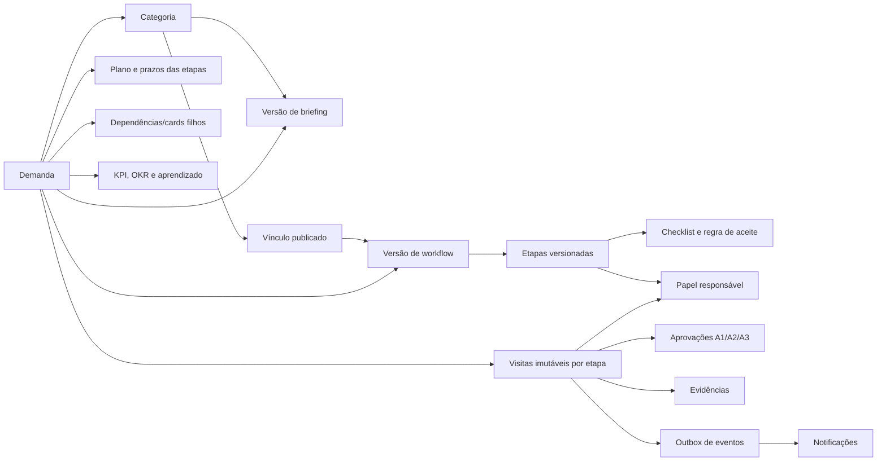

# Plano técnico — workflows especializados por categoria

**Data da análise:** 15/10/2026  
**Base funcional:** `Manual_Configuracao_Workflows_Marketing_Gomide_Codex.pdf`, versão 1.0  
**Código analisado:** commit `2a7efd8`  
**Escopo deste documento:** diagnóstico e plano. Nenhuma configuração, demanda ou vínculo de produção foi alterado.

## 1. Decisão operacional imediata

Não aplicar ainda a importação definitiva do Trello.

O importador atual atribui todas as demandas à versão do workflow padrão e tenta mapear as listas do Trello às etapas desse único fluxo. Se as 980 demandas forem aplicadas antes da especialização por categoria, elas nascerão ligadas ao fluxo genérico e exigirão uma segunda migração de alto risco.

A ordem segura é:

1. adicionar versionamento integral dos templates e trilha imutável de transições;
2. cadastrar os 13 conjuntos em estado `DRAFT`;
3. validar responsáveis, SLAs, risco A1/A2/A3 e checklists;
4. ativar os conjuntos para novas demandas, preservando as 8 demandas existentes;
5. atualizar a prévia do Trello para resolver categoria, workflow e etapa por cartão;
6. executar nova prévia, corrigir pendências e só então aplicar a importação.

## 2. Inventário atual validado

### 2.1 Produção

| Item | Estado encontrado |
|---|---|
| Categorias | 13 categorias ativas e com códigos estáveis |
| Vínculo categoria → workflow | Todas as 13 apontam para `Fluxo padrão` |
| Workflows | `Fluxo padrão` e `Vídeo` |
| Fluxo padrão | 8 etapas, 8 cards vinculados |
| Fluxo Vídeo | 1 etapa (`Briefing`), nenhuma categoria e nenhum card |
| Briefings | Os 13 modelos estão sem campos |
| Checklists | As 8 etapas do fluxo padrão e a etapa do fluxo Vídeo estão sem itens |
| Pessoas ativas | 5: conta institucional, João Guimarães, Maria Fernanda Tavares, Natália De Araujo Vieira e Sivas Junior |
| Cobertura de papéis | Há pessoas para estratégia, conteúdo, editorial/publicação e design; tecnologia, comercial, logística e várias validações especializadas ainda não têm usuário ativo identificado |

### 2.2 Modelo de dados existente

| Área | Estrutura atual | Avaliação |
|---|---|---|
| Categorias | `DemandCategory` com `code`, `default_workflow_id`, ativo e revisão otimista | Boa base; falta binding versionado e estado rascunho/publicado |
| Workflows | `Workflow` + `WorkflowStage` | Suporta múltiplos fluxos, ordem, cor, pessoa padrão e duração esperada |
| Versões | `WorkflowVersion.definition` | Versiona somente a lista básica de etapas; não captura briefing, checklist, regra de aceite, papel, risco ou condição |
| Briefing | `BriefingField` por categoria | Permite texto, texto longo, número, data e seleção; o template é mutável e não versionado |
| Respostas | `DemandBriefingAnswer` ligado ao campo atual | Preserva valor, mas a interpretação histórica pode mudar se o campo for renomeado/desativado |
| Checklist | `ChecklistTemplateItem` por etapa | Permite ordem, obrigatório e ativo; não há criticidade, evidência ou regra de aceite |
| Checklist do card | `DemandChecklistItem` ligado ao item de template | Registra conclusão, ator e horário; depende do template mutável |
| Demandas | `Demand` com categoria, workflow, versão, etapa, responsável, status, prioridade, prazo e esforço | Falta demandante, especialista, risco de aprovação, card-pai, dependências, KPI/OKR, evidência e aprendizado |
| Plano de etapas | `DemandStageInstance` | Guarda responsável, prazo, previsão, entrada e saída por etapa; a unicidade impede representar várias visitas à mesma etapa |
| Histórico | `DemandUpdate` + `AuditEvent` + `DemandRevision` | Base útil de auditoria; falta evento de transição normalizado e imutável com aceite/aprovação/evidência |
| Papéis profissionais | `JobRole` + `MemberJobRole` | Estrutura existe, mas etapas ainda apontam diretamente para usuário; não há código estável, substituto ou delegação temporal |
| Aprovações | Inexistente | Bloqueador para A1/A2/A3 e reprovação rastreável |
| Dependências | Inexistente | Bloqueador para cards-pai de Campanha e Evento |
| Evidências/KPI/OKR/aprendizado | Inexistente como entidades estruturadas | Conteúdo pode existir em texto/arquivo, mas não é validável nem mensurável |
| Notificações | Inexistente | Transições mudam o responsável, mas não geram caixa de notificação persistente |
| Tempo | `TimeEntry` com execução, pausa e conclusão | Mede trabalho; pausa do timer não representa pausa/bloqueio operacional da demanda |
| Retenção | Política de arquivamento a cada 60 dias e histórico preservado | Compatível com o objetivo, desde que novas entidades também não sejam apagadas |
| Importação Trello | Prévia, idempotência por board/card, lotes reversíveis e revisão de demanda | Boa base de governança; atualmente usa o workflow padrão para todos os cartões |
| Permissões | Administrador, coordenador, colaborador e visualizador | Adequado para acesso; é diferente do papel profissional responsável pela etapa |

### 2.3 Comportamentos atuais que precisam ser centralizados

1. O avanço normal valida checklist obrigatório e timer aberto, mas não valida briefing, aprovação, evidência, dependências ou Definition of Done.
2. O retorno pelo dock exige comentário; a mudança direta de etapa e a edição completa do card não aplicam a mesma regra em todos os casos.
3. `DemandStageInstance` atualiza `entered_at` e `left_at` ao retornar, portanto não preserva cada ciclo de revisão como visita separada.
4. O responsável de uma etapa é uma pessoa fixa, não um papel com substituição.
5. `Bloqueada` é tratada como status principal e `Pausada` não existe como estado operacional da demanda.
6. A criação rápida aceita demanda sem categoria. Isso pode continuar apenas como rascunho de triagem, sem autorização para avançar ao fluxo produtivo.
7. O versionamento atual não protege briefing e checklist de alterações posteriores.

## 3. Comparação com a especificação

| Requisito do manual | Cobertura atual | Alteração necessária | Prioridade |
|---|---|---|---|
| 13 categorias com fluxo próprio | Não atendido | Criar 13 workflows versionados e vinculá-los somente após homologação | P0 |
| Briefing especializado e obrigatório | Estrutura existe, modelos vazios | Template versionado, campos globais + específicos e gate de DoR | P0 |
| Checklist obrigatório por etapa | Estrutura existe, modelos vazios | Snapshot versionado, criticidade, evidência e validação unificada | P0 |
| Owner por papel e substituto | Parcial, pessoa fixa | `owner_role_id`, fallback, delegação e resolução no início da etapa | P0 |
| Histórico completo de transição | Parcial | Criar visitas/eventos imutáveis por passagem de etapa | P0 |
| Aprovação A1/A2/A3 | Não atendido | Política e registros imutáveis de aprovação/reprovação | P0 |
| Estados Bloqueada e Pausada transversais | Parcial | Separar estado operacional do status de ciclo de vida e medir intervalos | P0 |
| Cards-pai e dependências | Não atendido | Relações de dependência com bloqueio de conclusão | P0 para Campanha/Evento |
| Evidências de aceite | Parcial em arquivos/comentários | Entidade de evidência ligada à etapa, aprovação e conclusão | P0 |
| Categoria obrigatória | Parcial | Obrigatória ao entrar em produção; permitir `DRAFT/TRIAGE` sem categoria | P0 |
| Workflow excepcional por card | Permitido sem justificativa | Exigir motivo, permissão e auditoria | P1 |
| KPI/OKR/SMART estruturados | Não atendido | Templates, valores parametrizados e fonte/janela/baseline | P1 |
| Notificação após transição | Não atendido | Caixa interna persistente via outbox | P1 |
| Métricas de fluxo e retrabalho | Parcial | Calcular lead/cycle/stage/blocked/rework/first-pass/WIP | P1 |
| Aprendizado pós-publicação | Não atendido | Entidade com hipótese, resultado, período, fonte e decisão | P2 |
| Alerta 3 demandas semelhantes/60 dias | Não atendido | Detecção assíncrona e sugestão administrativa | P2 |

## 4. Arquitetura alvo

### 4.1 Evolução aditiva do banco

Manter as tabelas atuais e acrescentar estruturas. Não renomear nem remover colunas neste marco.

#### Templates e publicação

- `briefing_templates`: identidade estável do modelo por categoria.
- `briefing_template_versions`: estado `DRAFT|PUBLISHED|RETIRED`, número, definição JSON e autor.
- `category_template_bindings`: categoria, versão de briefing, versão de workflow, vigência e autor da ativação.
- ampliar o snapshot de `WorkflowVersion.definition` para incluir:
  - `ownerRoleId`;
  - `fallbackUserId`;
  - `slaHours` e calendário aplicável;
  - `acceptanceRule`;
  - `approvalPolicy`;
  - `conditionRule` para etapas condicionais;
  - itens de checklist com código, criticidade, evidência exigida e ordem.
- adicionar `briefing_template_version_id` e `category_binding_id` na demanda.

#### Papéis e cobertura

- acrescentar `code` estável a `JobRole`.
- criar `member_role_assignments` com prioridade, início, fim e indicação de substituto.
- etapas apontam para papel; a pessoa é resolvida e congelada ao entrar na etapa.
- workflow em rascunho pode ter papel sem ocupante; publicação deve mostrar alerta e exigir fallback autorizado.

#### Governança da execução

- `demand_stage_visits`: uma linha por entrada na etapa, inclusive retornos; ator, ação, origem, destino, motivo, responsável resolvido, timestamps e duração.
- `approval_requests` e `approval_decisions`: política, nível A1/A2/A3, papel/pessoa, decisão, comentário e horário; decisões não são apagadas após reabertura.
- `demand_dependencies`: `parent`, `blocks`, `relates_to`, estado e auditoria.
- `evidence_records`: tipo, URL/arquivo/referência, etapa, autor e horário.
- `demand_state_intervals`: `ACTIVE|BLOCKED|PAUSED`, motivo, início, fim e ator.
- `notification_outbox` + `notifications`: publicação após commit e entrega interna idempotente.
- `admin_overrides`: regra ignorada, justificativa, ator e snapshot da validação.

#### Inteligência

- `okr_definitions` e `demand_okr_links`.
- `kpi_definitions` e `demand_kpi_targets` com baseline, janela, fonte, unidade e meta opcional.
- `demand_learnings` com hipótese, resultado, período, fonte e decisão.

### 4.2 Migração e rollback

Usar estratégia expandir → preencher → validar → ativar:

1. migrations somente aditivas;
2. backfill com `source = legacy` e `inferred = true` quando reconstruído do histórico;
3. nenhuma demanda muda de categoria, workflow, etapa, status ou responsável durante o backfill;
4. aplicação aceita ler o modelo antigo e o novo sob feature flag;
5. rollback operacional desativa a flag e restaura o binding anterior, mantendo as novas tabelas;
6. nenhum downgrade que apague dados novos será executado em produção sem backup e autorização específica;
7. antes da ativação: snapshot do banco, contagens por tabela, relatório dos 8 cards atuais e teste de restauração.

## 5. Catálogo de workflows a cadastrar como rascunho

O manual descreve 13 categorias, 114 etapas e 145 campos específicos de briefing. Os responsáveis abaixo são **papéis configuráveis**, não IDs fixos de usuários.

| Categoria | Etapas e papel responsável | OKR | KPI principal |
|---|---|---|---|
| Automação | Briefing—Estratégia; Mapeamento—Tecnologia; Construção—Tecnologia; Testes—Tecnologia; Validação—Estratégia; Ativação—Tecnologia; Monitoramento inicial—Tecnologia; Concluída—Estratégia | O1/O4 | sucesso, falhas, intervenções, horas poupadas, recuperação |
| Blog | Briefing—Estratégia; Pesquisa/SEO—Conteúdo; Redação—Conteúdo; Revisão técnica—Especialista; Aprovação editorial—Estratégia; Publicação/SEO—Conteúdo; Distribuição—Editorial; Concluída—Editorial | O2/O3 | indexação, impressões, cliques, CTR, posição, conversões |
| Campanha | Briefing—Estratégia; Estratégia—Estratégia; Desdobramento—Editorial; Ativos prontos—Editorial; Tracking—Estratégia; Validação—Estratégia; Ativação—Estratégia; Otimização—Estratégia; Relatório—Estratégia | O1/O3 | leads, MQL, CPL, CPA, CTR, CPM, conversão, receita |
| Carrossel | Briefing—Editorial; Copy—Conteúdo; Design—Design; Revisão—Conteúdo; Aprovação—Estratégia; Legenda—Conteúdo; Agendamento—Editorial; Publicação—Editorial | O2/O3 | salvamentos, compartilhamentos, alcance, visitas, cliques |
| Endomarketing | Briefing—Estratégia; Estratégia—Estratégia; Copy—Conteúdo; Produção visual—Design; Validação—Estratégia; Distribuição—Editorial; Mensuração—Estratégia; Concluída—Estratégia | O1/O4 | adesão, participação, presença, respostas, feedback |
| Estático | Briefing—Editorial; Copy—Conteúdo; Design—Design; Revisão—Conteúdo; Aprovação—Estratégia; Agendamento—Editorial; Publicação—Editorial | O2/O3 | alcance, compartilhamentos, cliques, visitas, conversões |
| Evento | Briefing—Estratégia; Planejamento—Estratégia; Logística—Logística; Jornada comercial—Comercial; Comunicação—Editorial; Checkpoint—Estratégia; Execução—Comercial; Pós-evento—Comercial; Relatório—Estratégia | O1/O3 | inscrições, presença, show rate, CPL, reuniões, NPS |
| Landing Page | Briefing—Estratégia; Arquitetura/CRO—Estratégia; Copy—Conteúdo; Design—Design; Desenvolvimento—Tecnologia; Integrações—Tecnologia; QA—Estratégia; Publicação—Tecnologia; Monitoramento—Estratégia; Concluída—Estratégia | O3/O4 | sessões, conversão, leads, CPL, erros, performance |
| Material Gráfico | Briefing—Estratégia; Especificação—Design; Conteúdo—Conteúdo; Design—Design; Prova—Design; Aprovação—Estratégia; Produção—Logística; Recebimento—Logística; Concluída—Estratégia | O1/O4 | pontualidade, retrabalho, custo, erros, scans |
| Story | Briefing—Editorial; Roteiro—Conteúdo; Produção—Design; Revisão—Editorial; Aprovação—Editorial; Publicação—Editorial; Concluída—Editorial | O2/O3 | conclusão, saídas, respostas, cliques, leads |
| Vídeo Reels | Briefing—Editorial; Copy/roteiro—Conteúdo; Validação técnica—Especialista; Aprovação roteiro—Estratégia; Gravação—Design/audiovisual; Edição—Design/audiovisual; Finalização—Design/audiovisual; Legenda—Conteúdo; Aprovação final—Estratégia; Publicação—Editorial; Concluída—Editorial | O2/O3 | retenção, watch time, percentual assistido, compartilhamentos |
| Vídeo YouTube | Briefing—Estratégia; Pesquisa—Conteúdo; Roteiro—Conteúdo; Revisão técnica—Especialista; Aprovação—Estratégia; Gravação—Design/audiovisual; Edição—Design/audiovisual; Thumbnail—Design; SEO/publicação—Editorial; Aprovação final—Estratégia; Agendamento—Editorial; Concluída—Editorial | O2/O3 | CTR, retenção, watch time, inscritos, visualizações, leads |
| Outro | Triagem—Estratégia; Briefing—Estratégia; Planejamento—responsável definido; Produção—responsável definido; Revisão—revisor definido; Aprovação—Estratégia; Entrega—responsável definido; Concluída—Estratégia | O1 ou O4 | prazo, aceite, retrabalho, esforço |

### 5.1 Regras de geração dos checklists

Cada frase da coluna “Checklist obrigatório” do PDF será preservada como `acceptanceRule`. Os elementos separados por vírgulas ou conjunções serão cadastrados como itens atômicos para impedir que um único checkbox valide várias obrigações sem confirmação explícita.

Exemplo da etapa `Automação / Briefing`:

- problema definido;
- regra de negócio definida;
- critério de aceite definido.

Itens derivados do PDF entram como obrigatórios. Itens globais de DoR e DoD são compostos por herança do template global, evitando duplicar manualmente a mesma regra em 13 categorias.

### 5.2 Etapas condicionais

`Especialista` não deve ser um usuário genérico. A demanda deve informar domínio técnico e especialista responsável. Revisão técnica fica:

- obrigatória quando o assunto for técnico ou o risco for A3;
- resolvida por papel de especialidade;
- bloqueada se não houver pessoa ativa nem fallback aprovado;
- dispensável somente quando a regra condicional registrar que o tema não exige validação, com auditoria.

## 6. Motor único de transição

Todas as mudanças — dock, Kanban, edição do card, API, automação e importação — devem chamar o mesmo serviço de domínio.

Ordem de uma transição:

1. bloquear a demanda por revisão otimista;
2. validar categoria, binding e versão;
3. validar estado operacional e timer;
4. validar briefing/DoR;
5. materializar e validar checklist da visita atual;
6. validar evidências e dependências;
7. validar aprovação A1/A2/A3;
8. fechar a visita da etapa com ator e horário;
9. abrir nova visita e resolver papel → pessoa;
10. recalcular prazos proporcionais;
11. registrar atualização, auditoria e outbox na mesma transação;
12. entregar notificação de forma idempotente.

Retorno e reprovação exigem motivo e etapa de destino. Skip e override ficam restritos a administrador/coordenador com justificativa. A conclusão aplica DoD e dependências abertas.

## 7. Importação do Trello após a especialização

### 7.1 Lacuna atual

O preview atual mapeia cada lista do Trello para uma etapa do workflow padrão. O cartão recebe categoria por melhor correspondência de rótulo, mas continua com a versão do fluxo padrão. Isso não serve para workflows por categoria.

### 7.2 Novo fluxo de importação

1. carregar o JSON em staging sem criar demanda operacional;
2. identificar duplicidade por `board_id + card_id` e hash;
3. resolver pessoa, marca, categoria e prioridade;
4. resolver `lista Trello + categoria → etapa do workflow publicado`;
5. mostrar cartões sem categoria, pessoa ou etapa resolvida;
6. impedir aplicação enquanto houver erro obrigatório;
7. permitir decisão explícita: mapear, deixar em triagem rascunho ou excluir do lote;
8. congelar as versões de briefing/workflow escolhidas na prévia;
9. aplicar em lotes controlados, com `import_run` pai e batches filhos;
10. oferecer reversão na ordem inversa, preservando revisões e log.

Após o cadastro de Natália, a prévia deve ser executada novamente; não se deve presumir que todos os membros agora estão resolvidos.

Checklists vindos do Trello continuam como ToDos históricos/importados. Eles não devem marcar automaticamente os novos gates obrigatórios do workflow, salvo quando uma regra de mapeamento revisada declarar equivalência.

## 8. Plano de implementação por dependência

### Marco 0 — congelar baseline e aprovar configuração

**Prioridade P0. Sem alteração funcional.**

- exportar inventário dos 8 cards existentes;
- registrar contagens e revisão atual do banco;
- aprovar mapa papel → pessoas/fallbacks;
- confirmar SLAs e calendário de trabalho;
- confirmar regra de risco A1/A2/A3;
- confirmar se `Company` representa a “Marca” do manual;
- manter a importação do Trello somente em prévia.

**Saída:** matriz de decisões assinada e snapshot restaurável.

### Marco 1 — fundação versionada e histórico imutável

**Prioridade P0.**

- migrations aditivas de templates, binding, papéis, visitas e estado operacional;
- leitura dupla do legado e do novo modelo;
- backfill sem alterar os 8 cards;
- testes de invariantes e rollback por feature flag.

**Saída:** banco capaz de preservar o significado histórico antes de receber os novos modelos.

### Marco 2 — motor de governança

**Prioridade P0.**

- serviço único de transição;
- DoR, checklist crítico, aprovação, evidência, dependência e DoD;
- retorno/reprovação/override com justificativa;
- intervalos bloqueado/pausado;
- outbox e notificações internas.

**Saída:** nenhum caminho de interface contorna as regras.

### Marco 3 — templates do manual em rascunho

**Prioridade P0.**

- criar papéis por código;
- gerar 13 briefings, 13 workflows, 114 etapas e checklists atômicos;
- manter metas numéricas opcionais e marcadas como “a definir”;
- validar cobertura de responsáveis e condições técnicas;
- tela de comparar rascunho com versão publicada.

**Saída:** pacote pronto para homologação, ainda sem efeito nos cards.

### Marco 4 — homologação e ativação gradual

**Prioridade P0.**

- teste ponta a ponta das 13 categorias;
- publicar os bindings para novas demandas;
- manter `Fluxo padrão` como legado somente leitura;
- oferecer prévia individual para migrar os 8 cards atuais;
- não migrar automaticamente cards em andamento.

**Saída:** novas demandas especializadas; histórico antigo intacto.

### Marco 5 — importador Trello por categoria

**Prioridade P0 antes do upload definitivo.**

- staging, resolução por cartão, mapa categoria/lista/etapa e gates de erro;
- nova prévia do arquivo de 980 cartões;
- dry run com contagens e amostra;
- importação controlada, relatório final e teste de reversão.

**Saída:** Trello importado diretamente para versões corretas, sem duplicidade.

### Marco 6 — indicadores e aprendizagem

**Prioridade P1/P2.**

- lead time, cycle time, tempo por etapa e bloqueado;
- prazo, first-pass approval, ciclos de revisão, WIP, volume/pessoa;
- planejado vs. urgente e previsto vs. realizado;
- KPIs com baseline/janela/fonte e aprendizado pós-publicação;
- alertas de saturação e repetição da categoria Outro.

**Saída:** relatórios calculáveis e auditáveis.

## 9. Testes obrigatórios

### Backend

- versionamento não altera cards ligados à versão anterior;
- mudança de briefing/checklist cria nova versão;
- nenhum endpoint contorna o serviço de transição;
- DoR, checklist crítico, aprovação, evidência e dependência bloqueiam corretamente;
- retorno cria nova visita e preserva aprovações/checklists anteriores;
- bloqueio e pausa acumulam tempos distintos;
- resolução de papel congela pessoa e respeita substituto;
- prazos de etapas somam o prazo disponível por peso;
- admin override exige justificativa e aparece na auditoria;
- importação é idempotente, bloqueia pendências e reverte por lote.

### Frontend

- campos mudam conforme a categoria e mantêm valores da versão do card;
- mensagens apontam o gate pendente e abrem a aba correta;
- aprovação/reprovação/retorno funcionam em desktop e mobile;
- cards-pai exibem dependências e impedimento de conclusão;
- workflows em rascunho não aparecem como opção operacional;
- ausência de responsável/fallback é visível antes da publicação.

### Homologação funcional

Para cada uma das 13 categorias: criar, preencher briefing, avançar, reprovar, retornar, bloquear, pausar, retomar, anexar evidência, aprovar, concluir e conferir relatório/histórico.

## 10. Decisões de configuração

Confirmadas em 15/10/2026:

1. `Company` representa a Marca.
2. Sivas Junior e Junior (TI) são pessoas distintas: Sivas é designer; Junior é gestor de TI.
3. O sistema deve medir o tempo corrido real, sem descontar automaticamente noites, finais de semana ou feriados. Tempo ativo, bloqueado e pausado será mantido separadamente.
4. SLAs são opcionais e permanecerão nulos até existir histórico suficiente para definir metas realistas.
5. O cadastro inicial de marcas deve conter: Gomide Contabilidade, Expert Consultoria, Imposto no Bolso, EloFiscal, Eclusa, Gomide e Oliveira Advogados, Rafael Oliveira, Anderson Nunes e Retributária.

Ainda exigem validação antes da publicação dos templates:

1. associar os demais papéis a usuários e escolher fallbacks enquanto faltarem cadastros;
2. escolher especialista por domínio e regra para Anderson/Rafael;
3. definir defaults de risco por categoria e gatilhos de A3;
4. aprovar metas de OKR/KPI; até isso ocorrer, ficam nulas/“a definir”;
5. decidir se notificações da primeira versão serão somente internas ou também por e-mail;
6. aprovar a estratégia para os 8 cards existentes: permanecer no legado ou migrar individualmente;
7. revisar o novo preview do Trello antes da aplicação definitiva.

## 11. Critério para iniciar a próxima etapa

O Marco 1 está autorizado. O cadastro completo de todos os futuros responsáveis não bloqueia o desenvolvimento, porque os templates serão rascunhos; ele bloqueia apenas a publicação de workflows que não tenham titular nem fallback.
